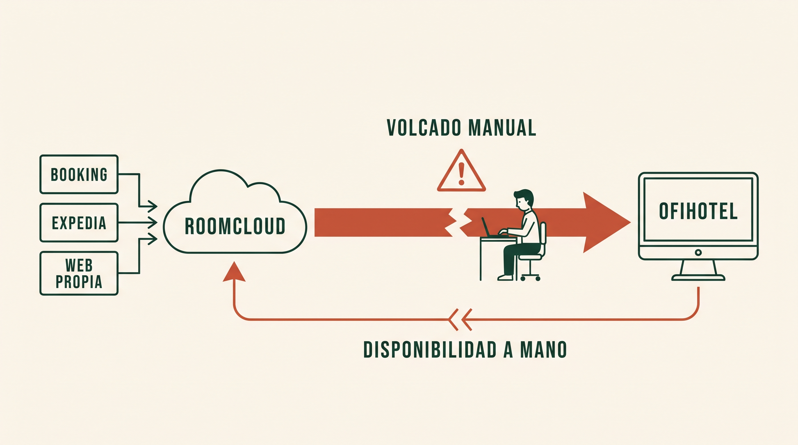

# El problema

> Descripción en crudo, tal como se recogió en la conversación con la dueña del hotel.
> Es un boceto hecho desde fuera del sector: no todo está verificado. Lo que sigue sin
> confirmar está marcado como tal.

## Contexto

Hotel familiar. El objetivo del proyecto es rediseñar los dos flujos por los que entra un
cliente —desde el **check-in** hasta el **check-out**— para ahorrar trabajo al personal y
que cualquiera pueda usarlos, **independientemente de sus conocimientos o aptitudes**.

El sistema actual está obsoleto y tiene fallos en producción.

Programas implicados:

| Programa | Papel | Fabricante |
|---|---|---|
| **OfiHotel** | PMS. El cerebro de la operativa: reservas, habitaciones, facturación, check-out | Ofimática (Barcelona) |
| **RoomCloud** | Channel manager. Unifica Booking, Expedia y la web propia; cierra habitaciones en los canales y ajusta precios según demanda | Tecnes Milano |

Persona clave: **Flor**, la empleada que hoy hace a mano el puente entre los dos programas.

---

## Flujo 1 — Cliente directo (puerta o correo electrónico)

1. El cliente llega por la puerta o escribe un correo y pide habitación.
2. Rellena en papel el formulario **BIENVENIDO**, con los datos necesarios para el check-in.
3. Paga.
4. Alguien **teclea a mano** los datos del BIENVENIDO en OfiHotel.
5. El cliente se aloja.
6. Check-out en OfiHotel (ver más abajo).

## Flujo 2 — OTAs (Booking, Expedia y web propia)

1. La reserva entra por Booking, Expedia o la web propia.
2. RoomCloud las recibe y las guarda todas en un mismo sitio.
3. **Flor vuelca a mano** cada reserva de RoomCloud a OfiHotel.
4. **Flor actualiza a mano** la disponibilidad en RoomCloud, para evitar overbookings: los
   dos programas no están sincronizados, y es RoomCloud quien cierra las habitaciones en
   Booking, Expedia y la web.
5. RoomCloud ajusta los precios según la demanda (con métricas que no conocemos).
6. El cliente se aloja.
7. Check-out en OfiHotel.

## El check-out (común a los dos flujos)

Se hace en OfiHotel con los datos que dejó el check-in. Excepción: si el cliente viaja por
trabajo para una empresa, los datos fiscales de la empresa se rellenan **en ese momento**
para poder emitir la factura correcta.

Siempre se hacen **tres acciones, a mano y por separado**:

1. Emitir la **factura**.
2. **Liberar la habitación** en OfiHotel.
3. **Enviar los datos del check-in a la policía**.

Nada obliga a que se hagan las tres: el sistema permite olvidarse de cualquiera.

---

## Retos identificados al principio

1. Poder **firmar digitalmente en tablet** en el momento del check-in. Es imprescindible.
2. Convertir las **tres acciones del check-out en una sola**.
3. **Sincronizar OfiHotel ↔ RoomCloud** sin intervención manual.

Propuestas iniciales, sin validar:

- Recoger los datos de la empresa ya en el check-in, para que el check-out sea automático.
- Un "programa maestro" sencillo que controle a los demás. Para eso OfiHotel tendría que
  tener API, cosa que se desconocía.

---

## Problemas detectados

Ordenados por lo que bloquea antes.

### Bloqueantes: sin resolverlos no se puede diseñar

1. **OfiHotel no tiene API pública.** Es el componente que más manda y el que menos se
   controla. Solo hay tres vías de entrada: un módulo de Ofimática, una integración
   certificada de un tercero, o escribir directamente en su base de datos SQL Server. La
   tercera rompe el soporte y arriesga la integridad de la facturación.
2. **Dependencia de un proveedor externo.** Casi todo camino viable pasa por que Ofimática
   colabore y por que haya contrato de mantenimiento al día. Ese calendario no es nuestro.
3. **Faltan datos.** Hay diez preguntas sin responder (ver al final).
4. **Riesgo de construir lo que ya existe.** OfiChannel conecta OfiHotel con RoomCloud
   como producto de catálogo (ver `02-investigacion.md`).

### Legales, con fecha

5. **Los partes de viajeros probablemente van fuera de plazo.** El plazo legal son 24 horas
   desde el inicio del servicio. Si se envían en el check-out, toda estancia de más de un
   día incumple. Sanciones de 100 € por parte a 30.000 € por no comunicar.
   *Sin confirmar: depende de cómo se envíen hoy.*
6. **El parte puede estar incompleto.** El RD 933/2021 exige datos del medio de pago. Si el
   BIENVENIDO no los recoge, cada parte es una infracción leve aunque llegue a tiempo.
7. **Datos de tarjeta en claro.** La API de RoomCloud devuelve número, CVC y caducidad de la
   tarjeta sin cifrar. Cualquier programa intermedio propio los recibe, y en cuanto tocan un
   log, un temporal o una base de datos, el proyecto entra en ámbito PCI-DSS.
8. **Papel con datos personales.** El BIENVENIDO en papel es un problema de RGPD por sí
   mismo: custodia, acceso, plazo de conservación y destrucción.
9. **Verifactu en 2027.** Obligatorio el 1 de enero de 2027 para sociedades y el 1 de julio
   para autónomos. No conviene tocar nada de facturación sin que Ofimática confirme por
   escrito que OfiHotel estará homologado.

### Técnicos

10. **Mapeo de habitaciones y tarifas.** Cada tipo de habitación y cada plan tarifario tiene
    que corresponderse uno a uno entre RoomCloud y OfiHotel. Si no, las reservas llegan sin
    decodificar y hay que tocarlas a mano: el mismo problema que se quiere eliminar.
11. **Quién manda sobre la disponibilidad.** Si los dos sistemas pueden modificarla, se
    pisan. Hay que decidir una única fuente de verdad antes de escribir código.
12. **El cursor de reservas de RoomCloud es compartido.** La llamada `reservations` con
    `useDLM="true"` devuelve lo nuevo desde *la última llamada*, y ese marcador vive en el
    servidor, por cuenta. Si dos integraciones llaman a la vez se roban las reservas entre
    ellas y se pierden en silencio.
13. **Cuotas de RoomCloud.** 15.000 filas de disponibilidad cada 180 minutos, 8 peticiones
    en cola, 3 activas, las modificaciones de una en una.
14. **La documentación de la API es de 2017** (versión 2.3.4). Puede estar desfasada.
15. **La firma digital no es capturar un trazo.** Para que valga hay que vincularla al
    documento concreto y sellarla en el tiempo.
16. **No hay entorno de pruebas para OfiHotel.** RoomCloud sí tiene; probar contra el PMS
    real es jugar con el inventario vivo.
17. **El hotel no se puede parar.** No hay fin de semana de corte: cualquier cambio tiene que
    ser incremental y con vuelta atrás.

### De personas y de proyecto

18. **Adopción.** Un sistema que recepción no entiende se abandona y se vuelve al papel, y
    entonces conviven los dos, que es peor que antes.
19. **Flor.** Hoy es un punto único de fallo (si se va de vacaciones, nadie vuelca), y puede
    vivir el proyecto como una amenaza a su puesto. Es también quien conoce el proceso real.
20. **El desarrollador es otro punto único de fallo.** Un sistema casero sin nadie que lo
    mantenga cuando cambie Booking o RoomCloud acaba siendo peor que el papel, porque el
    papel no se rompe solo.
21. **No hay línea base.** Sin saber cuánto tarda hoy el volcado ni cuántos overbookings hubo,
    no se puede justificar el gasto ni demostrar después que algo mejoró.

### Lectura de conjunto

- El problema **más caro** es el 5 (legal) y no espera al proyecto.
- El que **decide la arquitectura** es el 1 (OfiHotel sin API).
- Los que **deciden si el sistema sobrevive un año** son el 18 y el 20.
- Los técnicos son trabajo, no incógnitas.

El 7, el 12 y el 20 apuntan en la misma dirección: **cuanto menos código propio quede en
producción, mejor sale este proyecto.**

---

## Lo que todavía no sabemos

Cuestionario de campo para rellenar con la dueña, Ofimática, RoomCloud y Flor:
<https://claude.ai/code/artifact/1bc71cfb-6e7f-4424-8b71-0fd90e7a295a>

**OfiHotel**

1. ¿Qué versión corre, y está instalada en el hotel (SQL) o es OfiHotelCloud?
2. ¿Qué módulos están contratados? (La factura de Ofimática los lista por nombre.)
3. ¿Hay contrato de mantenimiento vivo? ¿Quién es el interlocutor?
4. ¿Cómo y cuándo se envían hoy los partes a SES.Hospedajes?

**RoomCloud**

5. ¿La cuenta es directa o a través de un revendedor (Parity Rate)?
6. ¿Hay usuario administrador de la extranet? ¿Pueden dar API key y `hotelId`?
7. ¿Cuántas habitaciones, cuántos tipos de habitación y cuántas tarifas?

**Operativa**

8. El formulario BIENVENIDO, campo por campo.
9. Check-ins al día en alta y en baja; minutos del volcado diario; overbookings del último año.
10. Medios de cobro, y dónde se guardan los datos fiscales de las empresas cliente.
